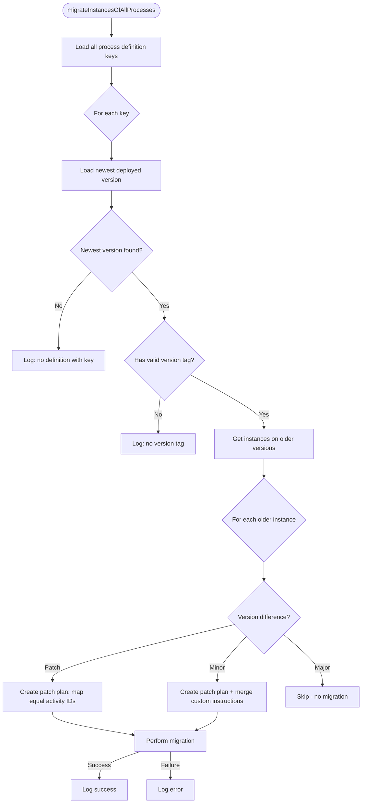

# Stop Migrating Camunda 7 Process Instances by Hand

Picture a fairly ordinary week on a team running Camunda 7 in production. A process model gets a
small improvement — maybe a bug fix in a service task, maybe a renamed activity that finally matches
the business language everyone actually uses. You deploy it. And now you have a decision to make:
what happens to the hundreds (or thousands) of process instances that are still happily running on
the *old* version of that model?

If you've been down this road before, you know the honest answer is usually "nothing happens to
them, because migrating them by hand is tedious and risky, so we just... leave them." Those
instances keep running on last month's logic indefinitely. And because they're still alive, you can't
even clean up the old Java Delegates or change a bean's method signature without risking a
`ClassNotFoundException` or a broken binding somewhere out in production. The old code becomes
permanent, not because anyone wants it to be, but because nobody wants to do the migration dance
instance by instance.

This is exactly the itch that **[camunda-process-instance-migrator](https://central.sonatype.com/artifact/de.envite.bpm/camunda-process-instance-migrator)**
scratches. It's a small, focused Java library that sits on top of Camunda 7's built-in migration
capabilities and turns "migrate everything that needs migrating" from a manual, per-instance chore
into a single method call you can run on every deployment. It supports Camunda Platform 7 and its two
actively maintained forks, [Operaton](https://operaton.org/) and CIB seven, since all three expose
the same underlying migration mechanics.

## Why the native Migration API isn't enough on its own

Camunda 7 does ship a [Migration API](https://docs.camunda.org/manual/latest/user-guide/process-engine/process-instance-migration/),
and it's genuinely solid — it can build a migration plan between two process definitions and execute
it against a running instance. The catch is that it's deliberately low-level: it migrates *one
specific instance* between *two specific definitions* that *you* identify. It has no opinion about
which definitions are "old" and which are "new," no way to discover instances that need migrating,
and no concept of doing this automatically across your entire deployment.

In practice, that means every migration involves the same repetitive groundwork: you have to go find
out which process definitions even exist, work out which deployed version is the newest one, hunt
down the instances still stuck on older versions, build a plan that maps old activity IDs onto new
ones, and then run that plan instance by instance. Do that by hand once and it's manageable. Do it
across a dozen process definitions on every release, and it quietly becomes a part-time job — one
that's easy to skip under deadline pressure, which is precisely how old instances end up living
forever.

The migrator exists to take all of that repetitive groundwork off your plate:

| Feature                             | Native Migration API              | + camunda-process-instance-migrator      |
|--------------------------------------|------------------------------------|-------------------------------------------|
| Find process definitions to migrate | Manual                            | Automatic                                 |
| Detect newest deployed version      | Manual                            | Automatic                                 |
| Find instances on older versions    | Manual                            | Automatic                                 |
| Build migration plan (patch-level)  | Manual                            | Automatic                                 |
| Build migration plan (minor-level)  | Manual                            | Semi-automatic (you supply instructions)  |
| Execute migration                   | Manual, instance by instance      | Automatic, engine-wide                    |
| Skip major-version instances        | Manual                            | Automatic                                 |

In other words: you keep using the same engine and the same underlying API you already trust, but
you stop being the one who has to glue all its pieces together every single time.

## Why this actually matters, beyond convenience

It's tempting to file this under "nice developer convenience," but the consequences of *not* having
it are more serious than that. If your process models evolve the way most agile teams evolve
anything — continuously, in small increments — then unmigrated instances cost you in two very
concrete ways.

First, they simply never benefit from whatever you just shipped. If the new version fixes a bug in
how a task is assigned, instances stuck on the old version keep exhibiting that bug, indefinitely,
even though a fix exists and is deployed right next to them.

Second, and more insidiously, those old instances pin your codebase in place. As long as a process
instance references a Java Delegate or a bean method the old way, you can't rename it, refactor it,
or remove it — because doing so would break every instance still running against the old
definition. Multiply that across several releases and you end up maintaining a slowly growing museum
of legacy code, purely to keep old instances from falling over.

Wiring this migrator into your deployment pipeline flips that dynamic. Old instances get walked
forward to the newest definition automatically, which means your "legacy code you can't touch" pile
stops growing — and can actually start shrinking.

## The idea that makes automatic migration safe: versioning as a contract

The reason the migrator can be this automatic without being reckless is that it leans entirely on one
convention: every process model carries a `Version Tag` in `MAJOR.MINOR.PATCH` form (say, `1.2.0`).
That tag isn't just metadata — it's the contract the migrator uses to decide *how much* it's allowed
to do on your behalf, and it borrows the same intuition semantic versioning uses for software
libraries.

- A **patch** bump (`1.0.0 → 1.0.1`) signals a small, structurally compatible change — renaming or
  adding an activity, swapping out a Java delegate. The migrator trusts this enough to build the
  migration plan itself, simply by mapping activity IDs that exist in both versions.
- A **minor** bump (`1.0.0 → 1.1.0`) signals something more disruptive to the process's shape — a
  wait-state's ID changed, a wait-state disappeared, or an activity moved into a subprocess. The
  migrator can't infer this mapping on its own, so it asks *you* to describe it once, via
  `MigrationInstructions`, and then handles the execution.
- A **major** bump (`1.0.0 → 2.0.0`) signals a genuinely breaking change. Here the migrator
  deliberately does nothing — it leaves those instances exactly as they are, on the assumption that
  if you broke compatibility on purpose, you don't want automatic migration second-guessing you.

Process definitions with no version tag, a malformed one, or a major version of `0` are treated as
not-yet-production-ready and skipped entirely, rather than guessed at.

Put together as a single automated run, calling `migrateInstancesOfAllProcesses()` walks every
deployed process through this logic:



Nothing here is magic — it's the same low-level Migration API Camunda already gives you, just driven
by a loop and a versioning convention instead of by a human clicking through Cockpit.

## Bringing it into your own project

The library is distributed as a plain Maven dependency, and because it's a thin Spring-friendly
layer on top of the engine, integrating it is mostly about wiring a bean and deciding when to call it.

### Step 1 — Add the dependency

```xml
<dependency>
  <groupId>de.envite.bpm</groupId>
  <artifactId>camunda-process-instance-migrator</artifactId>
  <version>2.1.2</version>
</dependency>
```

It's worth checking [Maven Central](https://central.sonatype.com/artifact/de.envite.bpm/camunda-process-instance-migrator)
for the latest release before you pin a version — this is an actively maintained project.

### Step 2 — Give it your `ProcessEngine`

For the simplest case — where every change you ship is a patch-level change — there's genuinely
nothing more to configure. You just hand the builder your existing `ProcessEngine` bean:

```java
@Configuration
public class MigratorConfiguration {

  @Autowired
  private ProcessEngine processEngine;

  @Bean
  public ProcessInstanceMigrator processInstanceMigrator() {
    return ProcessInstanceMigrator.builder()
        .ofProcessEngine(processEngine)
        .build();
  }
}
```

`ofProcessEngine` is overloaded for Camunda 7's, Operaton's, and CIB seven's respective
`ProcessEngine` types, so whichever fork you're on, the rest of your setup code is identical — you're
not locking yourself into a particular engine by adopting this library.

### Step 3 — Decide when migration runs

The migrator doesn't run itself; you decide the trigger. The most common choice is to run it once at
application startup, right after the new process definitions have been deployed, so that by the time
the application is serving traffic, old instances are already caught up:

```java
@Component
public class OnStartupMigrator {

  @Autowired
  private ProcessInstanceMigrator processInstanceMigrator;

  @EventListener(ApplicationReadyEvent.class)
  public void migrateAllProcessInstances() {
    processInstanceMigrator.migrateInstancesOfAllProcesses();
  }
}
```

You could just as easily expose this behind an internal REST endpoint and trigger it manually as part
of a release runbook — the library doesn't care how or when `migrateInstancesOfAllProcesses()` gets
called, only that it eventually does.

### Step 4 — Describe the mapping for minor version changes

Patch-level changes migrate for free because the migrator can match activity IDs that exist
identically in both the old and new definition. Minor-level changes break that assumption — an
activity you removed or renamed in a way that changes the process's shape has no obvious counterpart
for the migrator to find on its own. So for those cases, you describe the mapping once, and the
migrator takes care of applying it to every affected instance:

```java
@Bean
public ProcessInstanceMigrator processInstanceMigrator() {
  return ProcessInstanceMigrator.builder()
      .ofProcessEngine(processEngine)
      .withMigrationInstructions(generateMigrationInstructions())
      .build();
}

private MigrationInstructions generateMigrationInstructions() {
  return new MigrationInstructionsImpl()
      .putInstructions("Some_process_definition_key", Arrays.asList(
          MinorMigrationInstructions.builder()
              .sourceMinorVersion(0)
              .targetMinorVersion(2)
              .majorVersion(1)
              .migrationInstructions(Arrays.asList(
                  new MigrationInstructionImpl("UserTask1", "UserTask3"),
                  new MigrationInstructionImpl("UserTask2", "UserTask3")))
              .build()));
}
```

This example says: for process `Some_process_definition_key`, any instance between version `1.0.x`
and `1.2.x` should have its old `UserTask1` and `UserTask2` activities both remapped onto the new
`UserTask3`. A nice side effect of describing migrations this way is that you don't have to document
every intermediate hop a production environment might have skipped. If a long-running environment
jumps straight from `1.5.x` to `1.8.x`, instructions covering `1.5→1.6`, `1.6→1.7`, and `1.7→1.8` are
enough — the migrator chains them together itself to cover the full gap.

### Step 5 — Tune how aggressively migration runs

Migration isn't free of side effects, so the library lets you dial in behavior per process definition
rather than forcing one global policy on everything:

```java
MigrationProperties properties = new MigrationPropertiesImpl()
    .putSkipCustomListeners("Some_process_definition_key", true)   // default: true
    .putSkipIoMappings("Some_process_definition_key", true)        // default: true
    .putExecuteAsync("Some_process_definition_key", false);        // default: false

return ProcessInstanceMigrator.builder()
    .ofProcessEngine(processEngine)
    .withMigrationProperties(properties)
    .build();
```

The one worth paying attention to is `executeAsync`. Migrating a handful of instances is instant, but
migrating thousands of them is genuinely slow work for the engine — the README is upfront that it can
take "several minutes." If you're calling `migrateInstancesOfAllProcesses()` on application startup,
leaving that work synchronous means your application isn't considered "ready" until migration
finishes. Flipping it to asynchronous hands the work off to the engine's job executor instead, so your
startup (or your REST endpoint, or wherever you triggered it from) doesn't sit there blocked.

### Step 6 — Replace any piece that doesn't fit

Every meaningful behavior in the library — how instructions are sourced, how results are logged, how
older instances are found — is expressed as an interface with a sensible default implementation
behind it, and every one of them is swappable through the same builder:

```java
return ProcessInstanceMigrator.builder()
    .ofProcessEngine(processEngine)
    .withMigrationInstructions(new CustomJsonMigrationInstructionReader())
    .withMigratorLogger(new CustomMigratorLogger())
    .build();
```

This matters in practice because the most likely customization isn't "I want different migration
logic," it's "I want to source my instructions from a JSON file instead of Java code," or "I want
migration results to go to our structured logging pipeline instead of plain log lines." Rather than
forking the project for that, you implement the one interface you care about — `MigrationInstructions`
or `MigratorLogger` here — and leave everything else as-is.

## What to keep in mind before adopting it

No library is a free lunch, and a few constraints are worth knowing upfront rather than discovering
mid-migration:

- **It's Camunda 7 territory, not Camunda 8.** The library is built directly against the Camunda 7
  Migration API, so it covers Camunda Platform 7, Operaton, and CIB seven — not Camunda 8, which has
  an entirely different migration model.
- **Java 17 is the floor.** If you're on an older JDK, that's a prerequisite to clear first.
- **There's no safety net on minor instructions.** Camunda's own Cockpit EE migration wizard stops you
  from mapping, say, a wait-state activity onto a non-wait-state one. This library doesn't — it trusts
  you to only describe mappings that make sense, and testing those mappings is on you.
- **It's scoped to migration, deliberately.** Things like Process Instance Modification, or setting
  variables as part of a migration, aren't part of what this library does (yet).
- **Failures are isolated and logged, not thrown.** If one instance fails to migrate, that failure is
  caught, logged, and the rest of the batch keeps going rather than aborting everything. In practice
  that's rare, but it's exactly why checking your logs after a migration run is worth the habit — a
  silent, isolated failure is still a failure.

## The takeaway

If you recognize yourself in the opening scenario — new process versions going out regularly, old
instances quietly piling up because migrating them felt like more trouble than it was worth — this
library is built specifically for that situation. It doesn't replace or reinvent Camunda's migration
mechanics; it just removes the repetitive wiring around them, so that patch-level changes migrate
without you writing any code at all, and minor-level changes only ever need you to describe the
mapping once, in one place.

The project lives in its own repository, with issues and pull requests open to anyone who wants to
extend it further.
